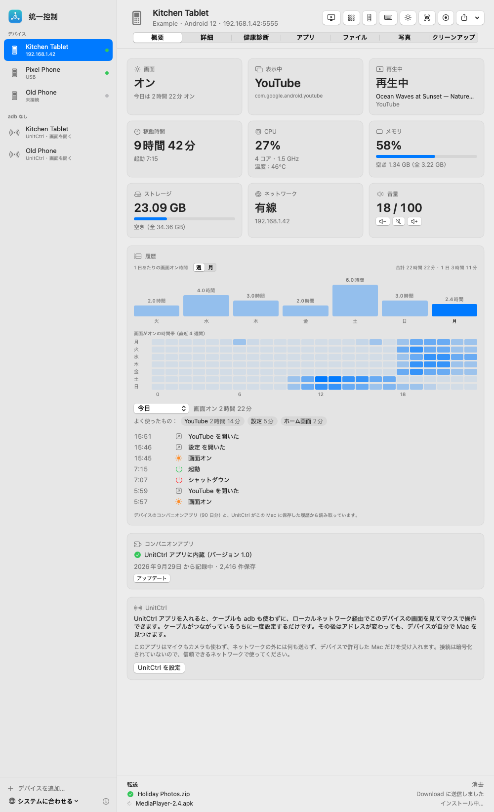
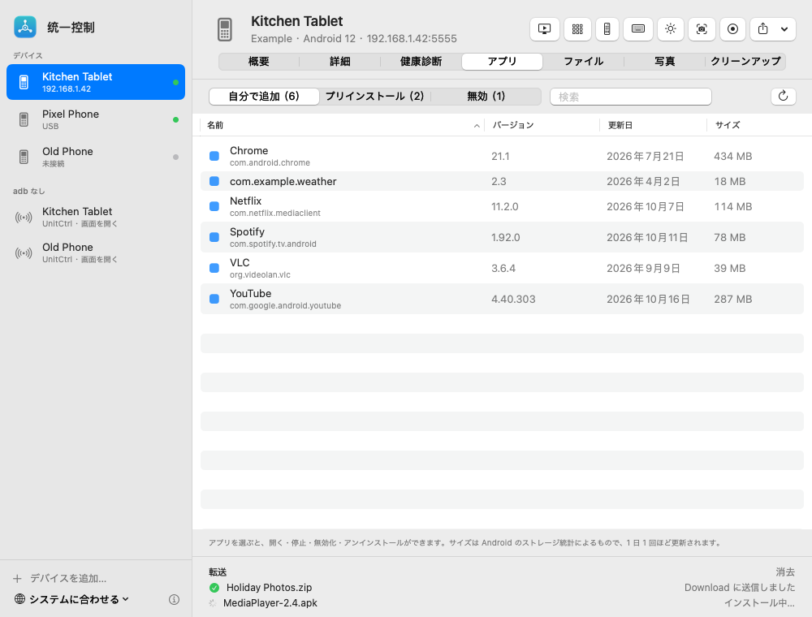
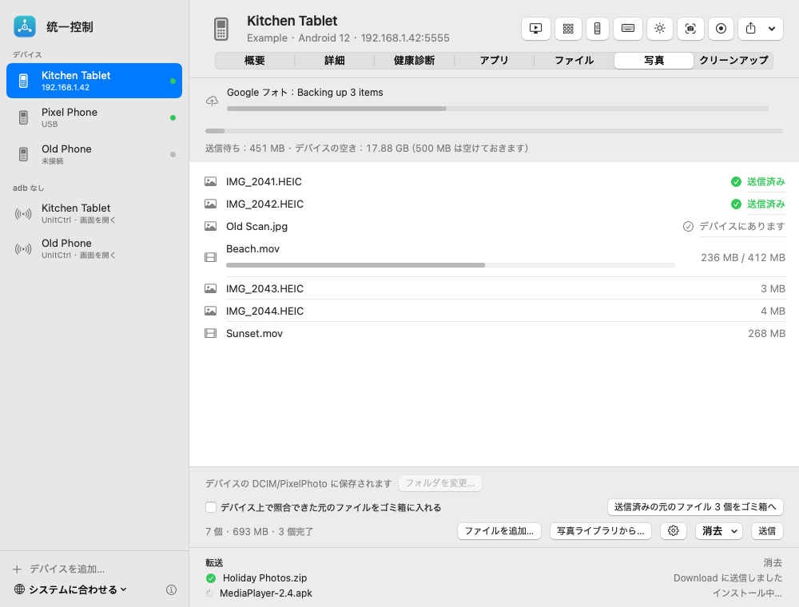
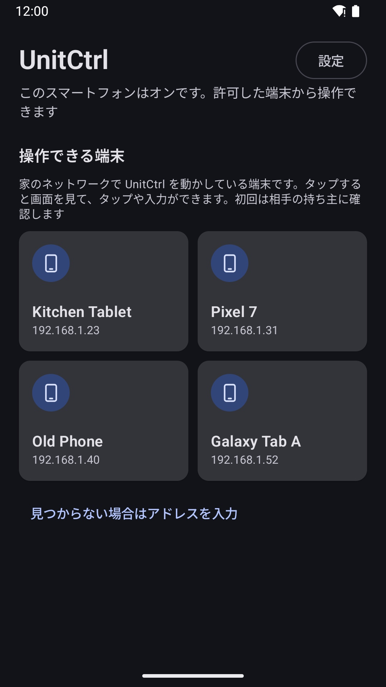
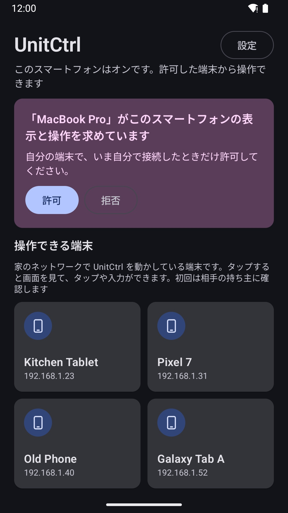

# UnitCtrl

[English](README.md) · [简体中文](README.zh-CN.md) · [繁體中文](README.zh-TW.md) · **日本語**

家の Android 端末を、Mac から、または端末どうしで見て操作できます。すべて家のネットワークの中だけで動きます。アカウント不要、クラウドなし、**広告は一切ありません**。

## できること

**Mac で**
- 家の Android スマートフォンやタブレットをひとつのウインドウで。USB でも Wi‑Fi でも
- 画面をリアルタイムで表示。マウスでクリック・ドラッグ・スクロール、Mac のキーボードで入力（どの言語でも）、音声も聞けます
- アプリ（起動・停止・アンインストール）、ファイル、スクリーンショットと画面収録、写真は端末のギャラリーへ直接転送
- 画面のオンやアプリの使用履歴、ストレージや状態がひと目で分かり、メニューバーで通知

**Android で**（[Google Play の UnitCtrl](#android)）
- 家のほかの端末がカードで並びます。タップすると画面を見て、タップや入力ができます
- ほかの端末から初めて操作しようとすると確認が出ます。「許可」するまで接続できません
- 各端末の使い方を選べます：操作する側、操作される側、または両方

## デモ動画

2 分間、Android 版を開いてからリモートでタップするまで：https://www.youtube.com/watch?v=ALaN3L4hSbw

## ダウンロード

### Mac
[Releases](https://github.com/zhaoweijia1997/UnitCtrl/releases) から **UnitCtrl-1.0.dmg** をダウンロードして開き、UnitCtrl をアプリケーションフォルダにドラッグします。macOS 14 以降、Apple シリコンと Intel に対応。

このアプリはまだ Apple の公証を受けていません。初回は **UnitCtrl を右クリック → 開く → 開く** を選んでください。USB で設定するには [adb](https://developer.android.com/tools/releases/platform-tools)（`brew install --cask android-platform-tools`）が必要です。入っていなければアプリが知らせます。

### Android
Android 版はいま **Google Play のクローズドテスト**中です。参加方法：
1. テストグループに参加：https://groups.google.com/g/unitctrl-testers
2. https://play.google.com/apps/testing/app.unitctrl を開き、「テスターになる」をタップ
3. 同じ Google アカウントで Google Play から UnitCtrl をインストール

Android 10 以降。

## はじめかた
1. スマートフォンで UnitCtrl をインストールし、一度開きます。
2. Mac で、スマートフォンを USB で接続（USB デバッグをオン）し、その端末のページで **UnitCtrl を設定** をクリック。または Wi‑Fi で見つかるのを待ちます（「adb なし」の欄）。
3. スマートフォンに確認が出たら、Mac を許可します。以降はケーブル不要です。

スマートフォンどうしで操作するには、両方で UnitCtrl を開きます。同じ Wi‑Fi なら互いに見つかります。

## プライバシー
UnitCtrl はデータを収集せず、家のネットワークの外には何も送信しません。リモートのタップは、許可した端末が接続している間だけ Android のユーザー補助サービスを使います。マイクとカメラは使いません。通信は暗号化されていないため、信頼できるネットワークでお使いください。詳しくは[プライバシーポリシー](https://github.com/zhaoweijia1997/UnitCtrl-Support)をご覧ください。

## フィードバック
sublueai@gmail.com、またはここで issue を作成してください。

UnitCtrl は無料で使えます。ソースコードは公開していません。
