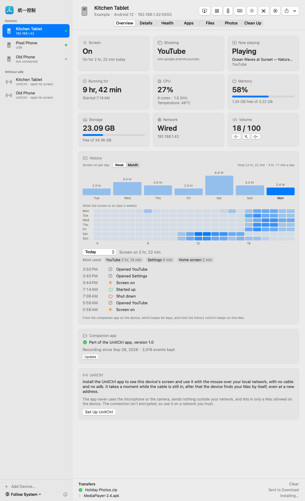
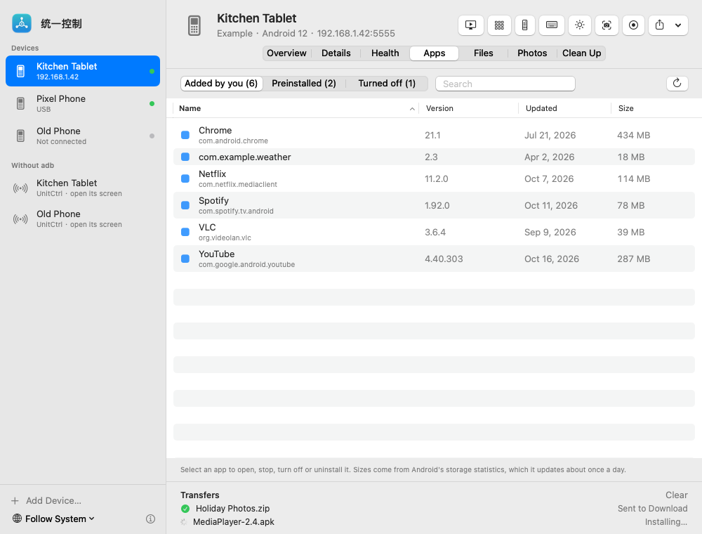
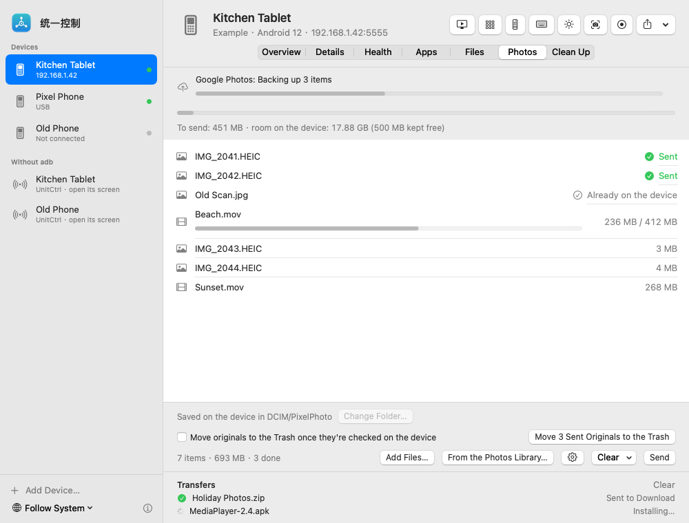
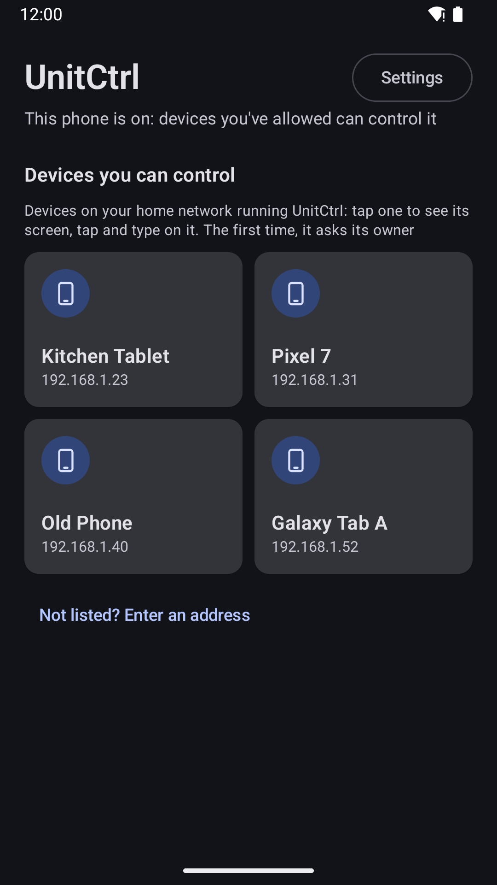
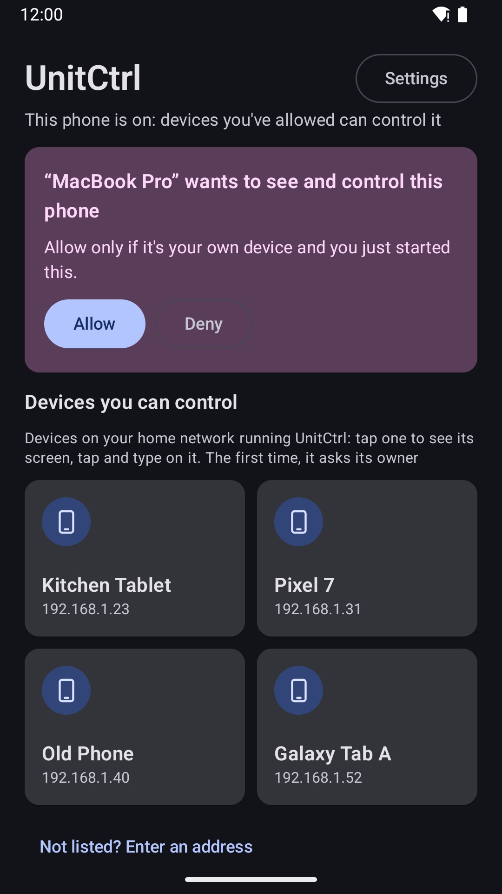
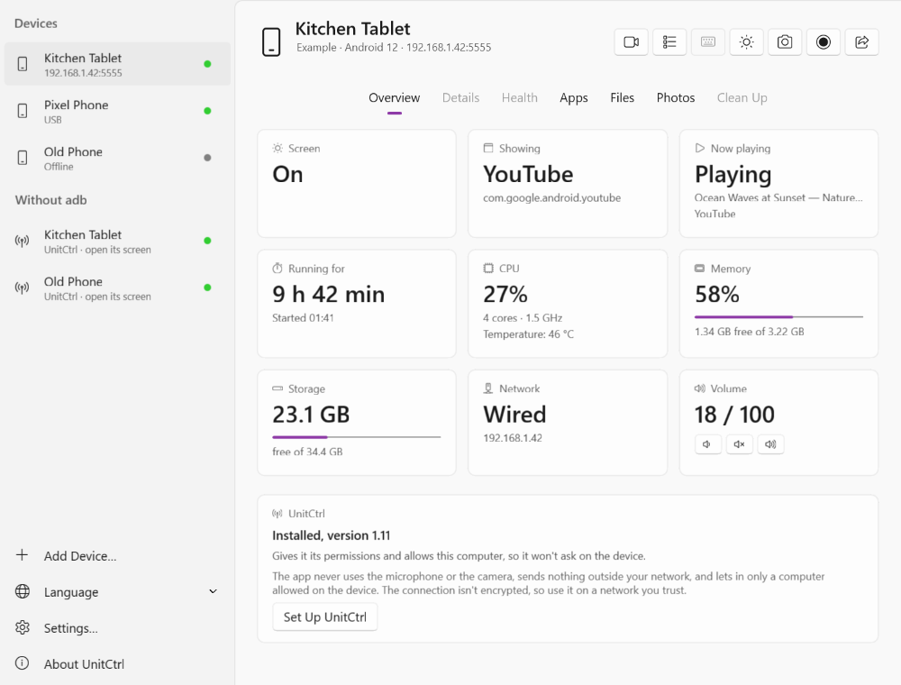

# UnitCtrl

**English** · [简体中文](README.zh-CN.md) · [繁體中文](README.zh-TW.md) · [日本語](README.ja.md)

See and control the Android devices at home — from your Mac, Windows or Linux PC, or from each other. Everything stays on your home network. No account, no cloud, **no ads, ever**.

## What it does

**On your Mac**
- Every Android phone and tablet at home in one window, over USB or Wi‑Fi
- See the screen live; click, drag and scroll with the mouse; type with your Mac keyboard in any language; hear the sound
- Apps (open, stop, uninstall), files, screenshots and screen recording, photos sent straight to the device's gallery
- Screen-on and app history, storage and health at a glance, notifications from the menu bar

**On Android** ([UnitCtrl on Google Play](#android))
- The other devices at home show up as cards: tap one to see its screen, tap and type on it
- The first time a device wants to control yours, you're asked — nothing gets in without your “Allow”
- Choose what each device is for: control others, be controlled, or both

## Demo video

2 minutes, from opening the Android app to tapping on another screen: https://www.youtube.com/watch?v=ALaN3L4hSbw

## Download

What's new in each version: [Version history](CHANGELOG.md).

Download UnitCtrl only from this page's [Releases](https://github.com/techinfo-apps/UnitCtrl/releases) or the official site https://techinfo-apps.github.io/ — the Releases page shows each file's SHA-256, so you can check a download wasn't changed.

### Mac
Download **UnitCtrl-1.2.dmg** from [Releases](https://github.com/techinfo-apps/UnitCtrl/releases), open it and drag UnitCtrl to Applications. macOS 14 or later, Apple silicon or Intel.

The app isn't notarized by Apple yet, so macOS stops it the first time. On macOS 14: **right-click UnitCtrl → Open → Open**. On macOS 15 and later: open it once, then go to **System Settings → Privacy & Security**, scroll down and click **Open Anyway** next to UnitCtrl. It needs [adb](https://developer.android.com/tools/releases/platform-tools) (`brew install --cask android-platform-tools`) for USB setup; it tells you if it's missing.

### Windows

Download **UnitCtrl-1.0-win-x64.zip** (or **UnitCtrl-1.0-win-arm64.zip** for an ARM PC) from [Releases](https://github.com/techinfo-apps/UnitCtrl/releases), unzip it anywhere and double-click UnitCtrl.exe — nothing to install. Windows 10 (2004 or later) or Windows 11.

The app isn't code-signed yet: if Windows says “Windows protected your PC”, click **More info → Run anyway**. The first time, you're asked to agree to the license agreement. USB setup needs [adb](https://developer.android.com/tools/releases/platform-tools) here too.

### Linux

Ubuntu 24.04+ / Debian 13+: download **unitctrl_1.0.0_amd64.deb** (or **_arm64.deb**) from [Releases](https://github.com/techinfo-apps/UnitCtrl/releases) and install it with `sudo apt install ./unitctrl_1.0.0_amd64.deb`. Other distributions: download **UnitCtrl-1.0.0-x86_64.AppImage** (or **-aarch64**), `chmod +x` it and run it — nothing to install.

Finding devices on your Wi‑Fi uses Avahi (`avahi-utils`); the .deb installs it, and without it you can add a device by its IP address. Live screen, typing and sound over your network work today; USB features come later.

### Android
UnitCtrl for Android is in a **closed test on Google Play** right now. To join:
1. Join the test group: https://groups.google.com/g/unitctrl-testers
2. Open https://play.google.com/apps/testing/app.unitctrl and tap “Become a tester”
3. Install UnitCtrl from Google Play with the same Google account

Android 10 or later.

## Getting started
1. On the phone: install UnitCtrl and open it once.
2. On the Mac: plug the phone in by USB (with USB debugging on) and click **Set Up UnitCtrl** on its Overview page — or just let UnitCtrl find it on your Wi‑Fi under “Without adb”.
3. Allow your Mac on the phone when asked. From then on no cable is needed.

To control one phone from another, open UnitCtrl on both; they find each other on the same Wi‑Fi.

## Privacy
UnitCtrl collects nothing and sends nothing outside your home network. Remote taps use Android's Accessibility service only while a device you allowed is connected. No microphone, no camera. The connection isn't encrypted, so use it on a network you trust. Details: [privacy policy](https://github.com/zhaoweijia1997/UnitCtrl-Support).

## Feedback
sublueai@gmail.com — or open an issue here.

UnitCtrl is free to use. The source code isn't published.

---

**Free forever. No ads, ever.** Small, lovely apps and games. Free, no ads, and private — your data stays on your own devices.

Contact: sublueai@gmail.com · Website: https://techinfo-apps.github.io/

 Buy the Developer a Coffee

Entirely up to you: it works the same either way. Every cup turns into the next update.

