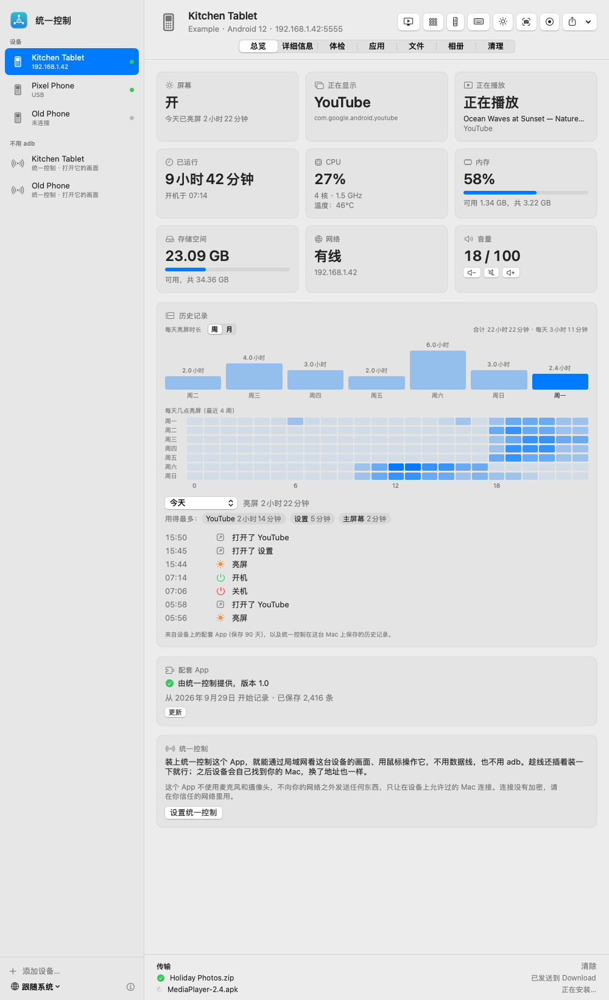
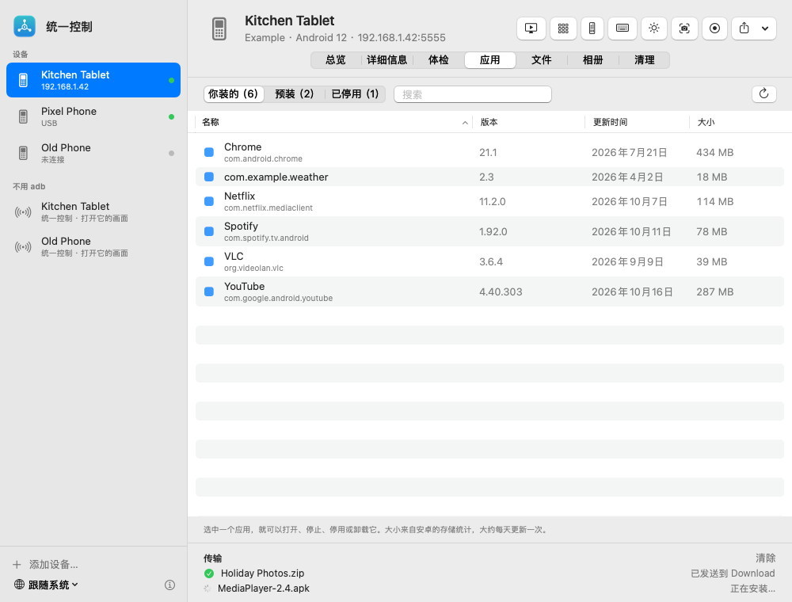
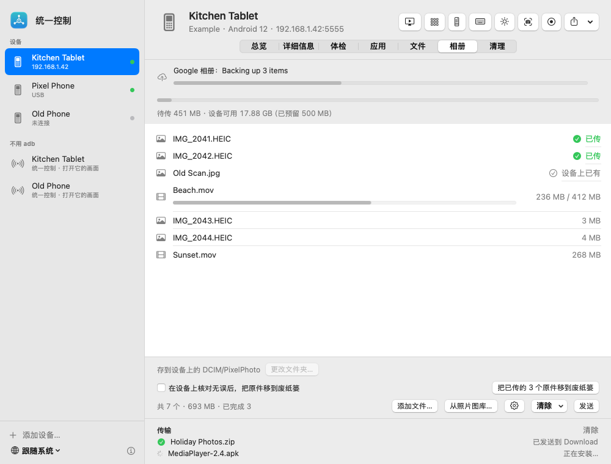
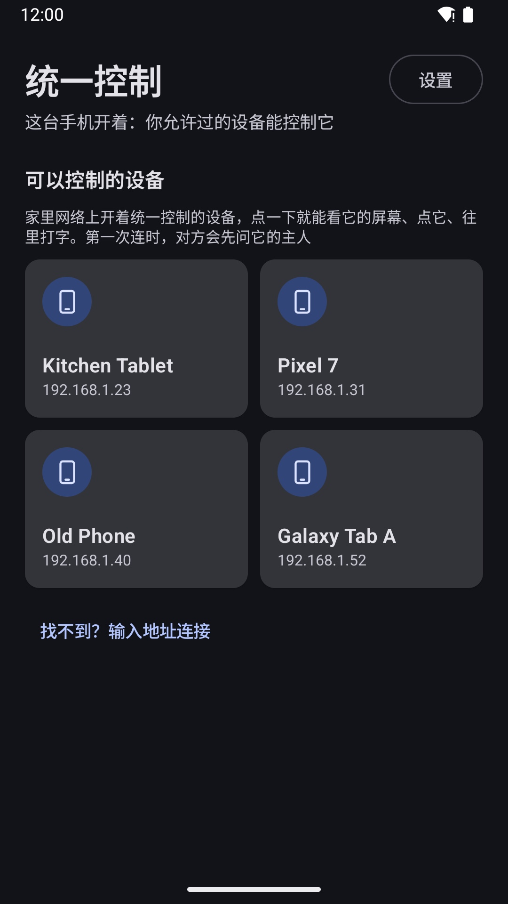
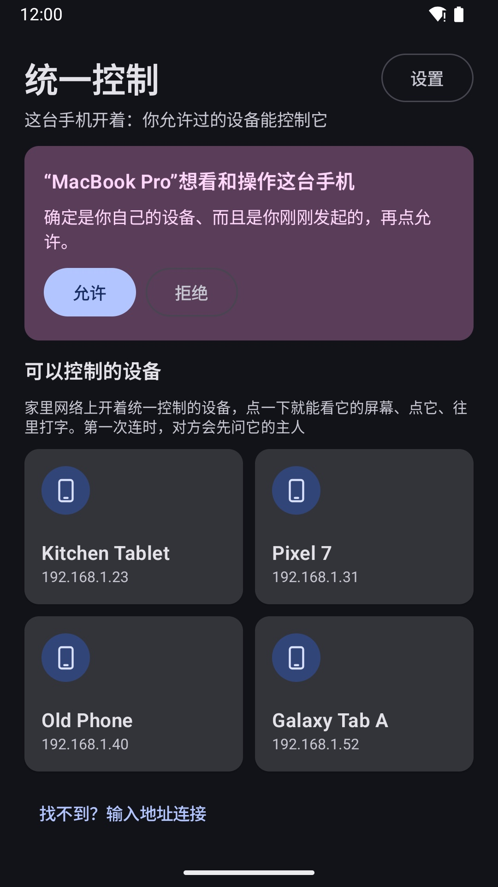
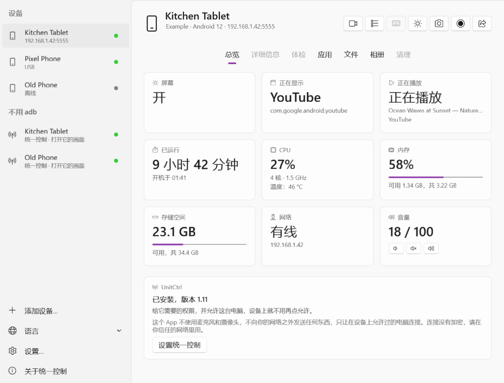

# 统一控制 UnitCtrl

[English](README.md) · **简体中文** · [繁體中文](README.zh-TW.md) · [日本語](README.ja.md)

用 Mac、Windows 电脑，或者在设备之间，查看并控制家里的安卓设备。一切都只在家里的网络里：不要账号，不经过云端，**永远没有广告**。

## 能做什么

**在 Mac 上**
- 家里所有安卓手机、平板都在一个窗口里，插线或走 Wi‑Fi 都行
- 实时看画面；用鼠标点、拖、滚；用 Mac 键盘打字（什么语言都行）；听它的声音
- 应用（打开、停止、卸载）、文件、截屏和录屏，照片直接传进设备相册
- 亮屏和应用使用记录、存储和健康状况一目了然，菜单栏里有通知

**在安卓上**（[Google Play 上的统一控制](#安卓)）
- 家里其他设备一张张列出来：点一下就能看它的屏幕、点它、往里打字
- 第一次有设备想控制你的设备时会先问你，你点“允许”才能进来
- 每台设备做什么你来定：只控制别人、只被控制，或者两样都要

## 演示视频

2 分钟，从打开安卓版到远程点一下：https://www.youtube.com/watch?v=ALaN3L4hSbw

## 下载

只从这里的 [Releases](https://github.com/techinfo-apps/UnitCtrl/releases) 或官网 https://techinfo-apps.github.io/ 下载统一控制。Releases 页面上每个文件都标着 SHA-256，可以核对下载的文件没被改过。

### Mac
到 [Releases](https://github.com/techinfo-apps/UnitCtrl/releases) 下载 **UnitCtrl-1.0.dmg**，打开后把统一控制拖进“应用程序”。需要 macOS 14 及以上，Apple 芯片和 Intel 都行。

这个 App 还没经过苹果公证，第一次打开时 macOS 会拦一下。macOS 14：**右键点统一控制 → 打开 → 打开**。macOS 15 及以后：先打开一次，再到**系统设置 → 隐私与安全性**，往下翻，点统一控制旁边的**仍要打开**。插线设置时需要 [adb](https://developer.android.com/tools/releases/platform-tools)（`brew install --cask android-platform-tools`），没装的话 App 会提示你。

### Windows

到 [Releases](https://github.com/techinfo-apps/UnitCtrl/releases) 下载 **UnitCtrl-1.0-win-x64.zip**（ARM 电脑选 **UnitCtrl-1.0-win-arm64.zip**），解压到任意文件夹，双击 UnitCtrl.exe 就能用，不用安装。需要 Windows 10（2004 或更新）或 Windows 11。

程序还没有代码签名：如果提示“Windows 已保护你的电脑”，点 **更多信息 → 仍要运行**。第一次打开时会请你同意用户协议。插线设置时同样需要 [adb](https://developer.android.com/tools/releases/platform-tools)。

### 安卓
安卓版现在在 **Google Play 封闭测试**中。加入方法：
1. 加入测试群组：https://groups.google.com/g/unitctrl-testers
2. 打开 https://play.google.com/apps/testing/app.unitctrl ，点“成为测试人员”
3. 用同一个 Google 账号在 Google Play 安装统一控制

需要安卓 10 及以上。

## 上手
1. 手机上：装好统一控制，打开一次。
2. Mac 上：用数据线连上手机（打开 USB 调试），在它的“总览”页点 **设置统一控制**；或者直接让统一控制在 Wi‑Fi 里找到它（在“不用 adb”一栏）。
3. 手机上弹出询问时，允许你的 Mac。之后就不用插线了。

想用一台手机控制另一台：两台都打开统一控制，连在同一个 Wi‑Fi 就会互相找到。

## 隐私
统一控制不收集任何数据，也不往家里网络以外发送任何东西。远程点按只在你允许过的设备连着时，才通过安卓的“无障碍”服务进行。不用麦克风，不用摄像头。连接没有加密，请在你信任的网络里用。详见[隐私政策](https://github.com/zhaoweijia1997/UnitCtrl-Support)。

## 反馈
sublueai@gmail.com，或者在这里提 issue。

统一控制免费使用，源代码不公开。

---

**永远免费，永远没有广告。** 只做小而美的软件和小游戏。免费，无广告，守护你的隐私——数据只留在你自己的设备上。

联系：sublueai@gmail.com · 官网：https://techinfo-apps.github.io/

 请作者喝咖啡

自愿的，不请也一样用。每一杯咖啡，都会变成下一次更新。

