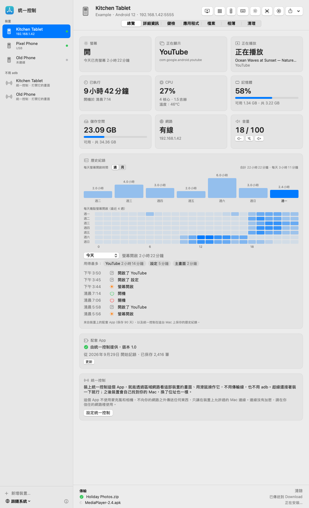
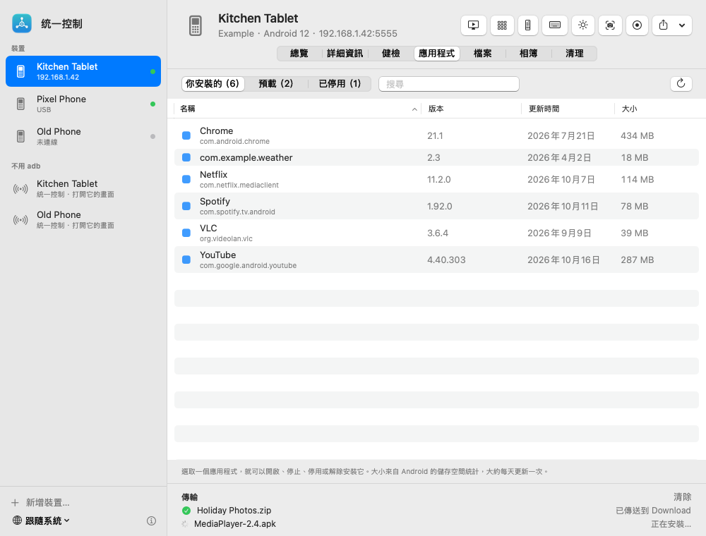
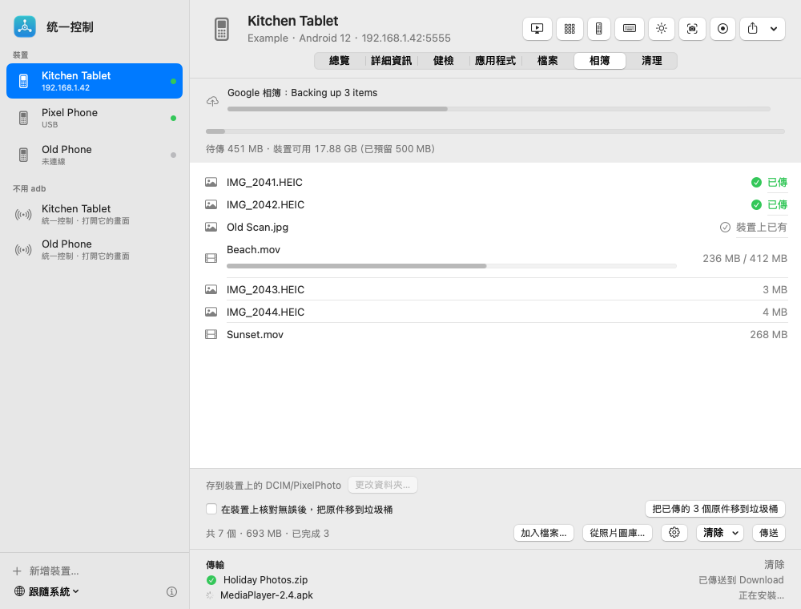
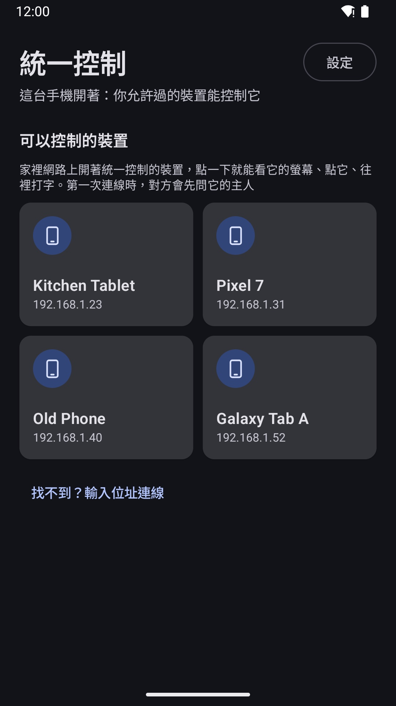
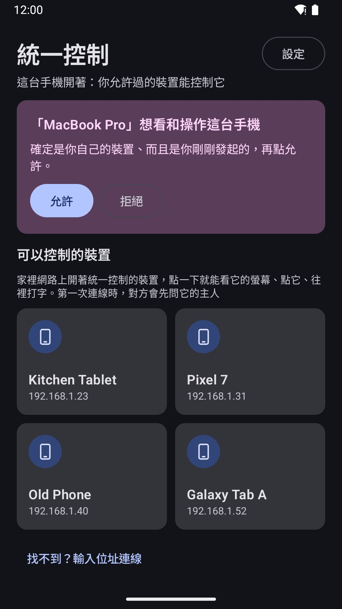

# 統一控制 UnitCtrl

[English](README.md) · [简体中文](README.zh-CN.md) · **繁體中文** · [日本語](README.ja.md)

用 Mac，或在裝置之間，查看並控制家裡的 Android 裝置。一切都只在家裡的網路裡：不需要帳號，不經過雲端，**永遠沒有廣告**。

## 能做什麼

**在 Mac 上**
- 家裡所有 Android 手機、平板都在同一個視窗裡，插線或走 Wi‑Fi 都行
- 即時看畫面；用滑鼠點、拖、捲動；用 Mac 鍵盤打字（任何語言都行）；聽它的聲音
- App（開啟、停止、解除安裝）、檔案、截圖和螢幕錄影，照片直接傳進裝置相簿
- 亮螢幕和 App 使用紀錄、儲存空間和健康狀況一目了然，選單列裡有通知

**在 Android 上**（[Google Play 上的統一控制](#android)）
- 家裡其他裝置一張張列出來：點一下就能看它的螢幕、點它、往裡打字
- 第一次有裝置想控制你的裝置時會先問你，你點「允許」才能進來
- 每台裝置做什麼由你決定：只控制別人、只被控制，或兩樣都要

## 示範影片

2 分鐘，從打開 Android 版到遠端點一下：https://www.youtube.com/watch?v=ALaN3L4hSbw

## 下載

只從這裡的 [Releases](https://github.com/techinfo-apps/UnitCtrl/releases) 或官網 https://techinfo-apps.github.io/ 下載統一控制。Releases 頁面上每個檔案都標著 SHA-256，可以核對下載的檔案沒被改過。

### Mac
到 [Releases](https://github.com/techinfo-apps/UnitCtrl/releases) 下載 **UnitCtrl-1.0.dmg**，打開後把統一控制拖進「應用程式」。需要 macOS 14 以上，Apple 晶片和 Intel 都可以。

這個 App 還沒經過 Apple 公證，第一次打開時 macOS 會擋一下。macOS 14：**按右鍵點統一控制 → 打開 → 打開**。macOS 15 及以後：先打開一次，再到**系統設定 → 隱私權與安全性**，往下捲，點統一控制旁邊的**仍要打開**。插線設定時需要 [adb](https://developer.android.com/tools/releases/platform-tools)（`brew install --cask android-platform-tools`），沒裝的話 App 會提示你。

### Android
Android 版現在在 **Google Play 封閉測試**中。加入方法：
1. 加入測試群組：https://groups.google.com/g/unitctrl-testers
2. 打開 https://play.google.com/apps/testing/app.unitctrl ，點「成為測試人員」
3. 用同一個 Google 帳號在 Google Play 安裝統一控制

需要 Android 10 以上。

## 上手
1. 手機上：裝好統一控制，打開一次。
2. Mac 上：用傳輸線連上手機（開啟 USB 偵錯），在它的頁面裡點 **設定統一控制**；或直接讓統一控制在 Wi‑Fi 裡找到它（在「不用 adb」一欄）。
3. 手機上跳出詢問時，允許你的 Mac。之後就不用插線了。

想用一支手機控制另一支：兩支都打開統一控制，連在同一個 Wi‑Fi 就會互相找到。

## 隱私
統一控制不收集任何資料，也不往家裡網路以外傳送任何東西。遠端點按只在你允許過的裝置連線時，才透過 Android 的「無障礙」服務進行。不用麥克風，不用相機。連線沒有加密，請在你信任的網路裡使用。詳見[隱私權政策](https://github.com/zhaoweijia1997/UnitCtrl-Support)。

## 意見回饋
sublueai@gmail.com，或在這裡開 issue。

統一控制免費使用，原始碼不公開。

---

**永遠免費，永遠沒有廣告。** 只做小而美的軟體和小遊戲。免費，無廣告，守護你的隱私——資料只留在你自己的裝置上。

聯絡：sublueai@gmail.com · 官網：https://techinfo-apps.github.io/

 請作者喝咖啡

自願的，不請也一樣用。每一杯咖啡，都會變成下一次更新。

